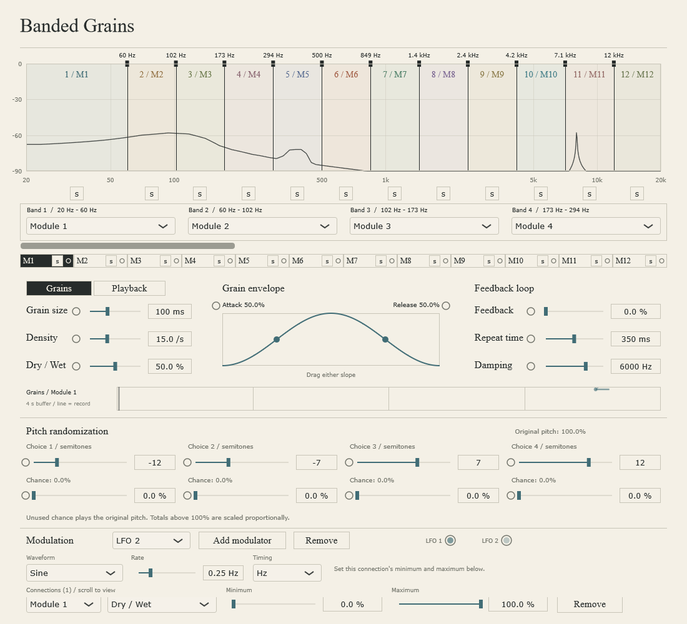

# Banded Grains

A Windows x64 VST3 audio effect built with C++17 and JUCE 8.0.12.

Insert it on an audio track and feed it sound. This is an effect, not a synthesizer.

## Controls

- **Grain size:** 20–250 ms. Length of each snippet of recent audio.

- **Density:** 2–40 grains per second. Low settings give separated snippets; higher settings overlap.

- **Dry / Wet:** 0–100%. Start at 50%; use 100% to hear just the grains.

- **Grain envelope:** drag each slope independently. Attack and release each span
  2.5-50% of the grain duration, using smooth cosine fades.
- **Pitch randomization:** four choices per module, -24 to +24 semitones, each with
  a playback probability. Unassigned probability plays the original pitch. Totals
  above 100% are scaled proportionally; the labels show actual chances.
- **Feedback:** 0-95% of wet grains returned to the recording buffer, before Dry/Wet.
- **Repeat time:** 10-2000 ms of delay inside the feedback loop. Grain capture and
  playback add their own latency, so the audible repeat interval is longer and diffuse.
  Time changes glide smoothly and can bend the pitch of the returned signal.
- **Damping:** 100-20000 Hz low-pass cutoff inside the feedback loop. Saturation inside
  the loop limits buildup. Each module has its own loop; bands sharing a module share feedback.

## Playback and grain display

Use **Grains** for timing, envelope and feedback controls; use **Playback** for capture
and playback controls. Both panels edit the selected module.

- **Position:** 0-1500 ms of extra capture lookback behind the safety offset needed
  for grain duration and pitch. Higher settings read older audio.
- **Spray:** 0-1000 ms total randomized position width centered on Position. Negative
  offsets clamp to zero; offsets also clamp to the valid four-second buffer region.
- **Base pitch:** -24 to +24 semitones added to each randomized pitch choice. Combined
  pitch is bounded to -36/+36 semitones. Existing pitch probabilities remain independent.
- **Reverse chance:** 0-100% probability that a newly launched grain plays backward.
- **Stereo spread:** random per-grain stereo balance, 0-100%. At zero, stereo channels
  retain their original balance. Mono hosts remain mono.
- **Freeze buffer:** stops recording into that module's buffer while grains continue
  playing the captured material. Dry audio remains live. Frozen audio is not serialized;
  preset/session recall starts unfrozen so it can capture fresh audio. A frozen empty
  buffer is silent. Feedback recording resumes when the buffer is unfrozen.

The grain display below the module controls shows the selected module's four-second
recording buffer. The vertical cursor is the recording head; moving dots and arrows
are live grain read heads. Brightness follows the grain envelope. Frozen capture holds
its recording head while grain read heads continue moving. Audio-thread snapshots pass
through a bounded FIFO; visualization performs no audio-thread drawing or allocation.

## Modulation and patch cables

The bottom panel contains up to four shared modulation sources. Each can have four
connections across any of the twelve modules. Add a source, choose its waveform
(sine, triangle, ramp up/down, square or random hold), then drag its output socket
onto a control's input socket. Hover a module tab while dragging to open that module.

Each connection stores its own destination module, destination control, minimum and
maximum. Endpoint fields display the destination's units and accept typed values.
Select the source to edit its connections; scroll the connection list to reach each
row. Click a connected control's input socket to reveal its connection. Remove a
connection to restore the control's base value. Reversed endpoints invert a connection.
If multiple connections target the same control, the last connection in source/row
order wins. Base controls and DAW automation remain unchanged by modulation.

Wires are hidden normally. Hover an output socket to see its outgoing cables, or an input to see all incoming cables. Destinations in
other modules connect to an input symbol on the module tab; destinations in the open
module connect directly to the control socket. A dragged cable is visible while patching.

Sources run at 0.02-20 Hz or tempo-based cycle lengths (sixteenth note through 16 beats).
Tempo-based sources pause with stopped transport; without host tempo they use 120 BPM.
Their phase restarts on audio preparation and otherwise runs continuously; this is
rate synchronization, not transport-position locking. Modulation updates every fixed
audio chunk of at most 256 samples. Grain settings take effect on newly launched grains.
Feedback, delay, damping and mix changes are smoothed.

## Spectrum and routing

The interface uses warm paper tones, serif headings and fine divider lines.

The spectrum shows the incoming stereo audio on a logarithmic frequency axis, before any

granular processing. Its FFT runs on the interface thread using a bounded audio FIFO.

- Double-click inside the spectrum to insert a crossover: up to twelve frequency sections and twelve independent modules.

- Drag a divider left or right to adjust its frequency.

- Right-click a divider to remove it (the lower section's routing is retained).

- Use each section's dropdown to choose any of the twelve modules.

- Scroll the band routing row horizontally to reach additional bands.

- Click the boxed **s** directly underneath a frequency band in the spectrum to hear that
  range before granular processing. Buttons follow the band boundaries as they move.
  The active button has a bright letter on a dark background. Only one band is auditioned at a time. Click again to
  restore the full output. Switching is crossfaded; adding/removing bands or recalling
  a preset ends auditioning. Solo is temporary and is not saved in the DAW project.
- Click the module tabs to edit independent timing, mix, envelope and pitch settings.
- Each module also has a boxed **s** inside its selector, immediately left of its connection socket. This solos its complete
  processed output, including grain and feedback tails. All engines keep running
  while soloed, and transitions use a short fade. Module solo and raw band audition
  replace one another; click the active button again to restore the full mix. Module
  solo is temporary and ends on preset recall or band layout changes.

These are twelve internal processors inside one VST3 instance. Each section has one destination;

multiple sections may feed the same module, where they are summed before grain processing.

Module outputs are summed to the main stereo output. Module tails may continue after rerouting.

The default is one full-range section feeding Module 1, matching the original simple effect.

All settings, including crossovers and routing, save with the DAW project and support automation.

Crossovers use 24 dB/octave Linkwitz-Riley filters with phase compensation. Frequency

sections have overlapping transition slopes, not brick-wall isolation. Recombining dry

sections has flat magnitude; filtering changes phase. Moving crossovers and changing routes

are smoothed, but adding/removing entire sections resets crossover state and can make a brief

transient, so create the section layout before recording a final take.

Each grain reads from a randomized position in the recent past, chooses a pitch from the module's probabilities,

and uses the selected attack and release envelope. Left and right share grain timing and position; Stereo spread adds per-grain balance. This version

has no file loading. Pitch shifting uses interpolated playback;

it also changes the playback speed within a grain. Grain duration remains fixed.

The wet signal has an audible delay and a short startup fill time, inherent to reading

past audio. The dry signal stays immediate. Sparse settings can be quiet or have gaps.

Overlap compensation controls average level but is not a peak limiter.

## Build

Run `powershell -ExecutionPolicy Bypass -File .\build.ps1` from this directory.

The script reuses the installed Visual Studio 2022 C++ compiler, Windows SDK and CMake.

It downloads the pinned JUCE source only if missing, builds Release, and runs DSP tests.

No full Visual Studio editor or Projucer needs to be launched.

Output: `build/Granular_artefacts/Release/VST3/Banded Grains.vst3`.

The latest packaged build is in `dist/Banded Grains-Windows-x64.zip`.

This is a **bundle folder**: copy the entire folder, not only its internal binary,

to a VST3 location scanned by your DAW. The standard system location is

`C:\Program Files\Common Files\VST3` (copying there may need administrator permission).

Alternatively, add the output directory as a custom VST3 scan path if your DAW supports it.

Look for **Banded Grains** under manufacturer **Granular**. No DAW rescanning is performed

by the build script or tests. Close existing plugin instances before replacing the installed bundle.

## Where to extend it

- `Source/GranularEngine.h`: rolling buffer, fixed pool of grains, scheduling, envelope and mixing.

- `Source/BandSplitter.h`: crossovers and phase compensation.

- `Source/PluginProcessor.cpp`: twelve modules, shared modulation, routing, spectrum FIFO, JUCE parameters and state saving.

- `Source/PluginEditor.cpp`: paper-toned interface, FFT spectrum, gestures and envelope preview.

- `Tests/GranularEngineTests.cpp`: dry passthrough, wet activity, finite output under automation,

  stereo alignment, buffer wraparound and clearing on reinitialization at three sample rates.

- `Tests/PluginCheck.cpp`: actual VST3 loading and audio processing; direct editor gesture tests;

  crossover flatness/isolation at three sample rates; frequency-specific routing; state recall;

  mono/stereo audio and variable block sizes. Accepts an optional output PNG path for a UI preview.

All audio memory is allocated during preparation. Processing performs no allocations,

file operations or locking. Grain size, envelope and pitch are captured at launch; dry/wet and overlap

gain are smoothed. The spectrum never performs an FFT or drawing on the audio thread.

JUCE is a third-party dependency with its own license; see `JUCE/LICENSE.md` before distribution.

